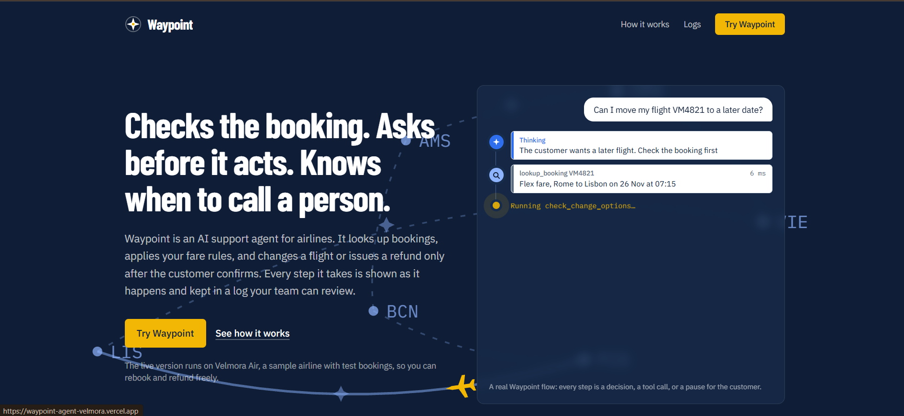
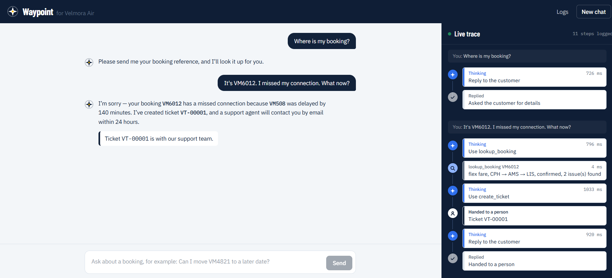
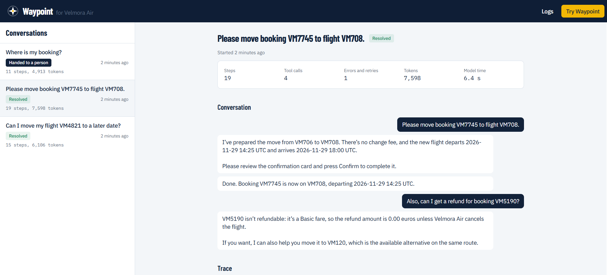
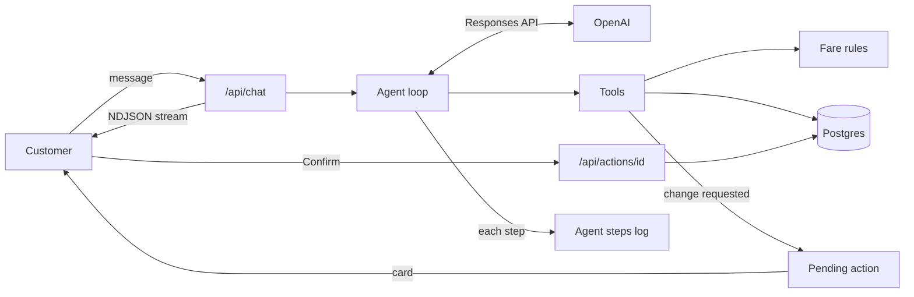

# Waypoint

An AI support agent for Velmora Air. It looks up bookings, checks fare rules, prepares rebookings and refunds, and hands off to a human when a case needs one. Every change waits for the customer to confirm it, and every step the agent takes is saved and shown live.

**Live app:** https://waypoint-agent-velmora.vercel.app/



## Demo

The recording opens on the home page, runs three support chats, then reviews them on the Logs page.

[Watch the demo video](screenshots/waypoint-demo-small.mp4)

| Chat with live trace | Conversation logs |
|---|---|
|  |  |

## What it does

- Finds a booking from its reference and explains the flights on it
- Checks change options and fees against fare rules written in code
- Prepares a rebooking or refund as a card the customer must confirm
- Handles cancelled flights, delays and missed connections
- Retries a failed rebooking once and opens a ticket if it fails again
- Escalates to a human agent with a ticket when the rules don't cover the case
- Asks for a booking reference before it uses any tool

Each visitor gets a private copy of six sample bookings, so anyone can try every case without affecting other visitors.

| Booking | Case |
|---|---|
| VM4821 | Flex fare, free move to a later flight |
| VM3307 | Cancelled flight, full refund |
| VM5190 | Basic fare, change with a 60 euro fee, refund not allowed |
| VM2654 | Gold member, fee waived |
| VM6012 | Delay causes a missed connection |
| VM7745 | Rebooking fails once, then the retry runs |

## How it works



**Agent loop.** A hand-written loop calls the model with function tools and runs at most eight model calls per message. Tool arguments are checked with Zod before anything runs. A tool returns either data or an error marked as retryable, and retryable errors are tried twice.

**Human confirmation.** Tools never change a booking directly. They create a pending action, and the customer sees a card with the new flight, the fee or the refund amount. The server applies the change only after Confirm, with a row lock so a double click can't apply it twice.

**Rules in code.** Change fees, refund amounts and status perks live in `lib/agent/rules.ts`. The model explains the result and the code decides it.

**Guards.** A tool call is rejected if its booking reference doesn't appear in what the customer wrote, so the model can't invent one.

**Live trace.** Every step (thinking, tool call, rule check, waiting for confirmation, ticket, error) is saved to `agent_steps` and streamed to the trace panel next to the chat.

**Logs.** The Logs page lists every conversation with its outcome (resolved, escalated, open or clarification) and replays the full step history.

## Evaluation

`eval/` holds 13 scenarios that cover every sample booking, refusals, escalation, a missing reference and the retry path. Each scenario checks which tools ran, which must not run, and what the reply says.

| Result | Tokens | Time |
|---|---|---|
| 13 of 13 passed | about 46,000 in total, about 3,500 per conversation | 84 s |

```bash
npx tsx eval/run-eval.ts
```

## Limits

With `DEMO_MODE=true` each visitor can send 20 messages a day and the whole app accepts 300 a day. Both numbers come from environment variables. Visitors are told apart by an anonymous cookie, with no sign-in.

## Stack

- Next.js 16 (App Router), TypeScript, Tailwind CSS v4
- OpenAI Responses API with strict function tools and streaming
- Postgres with Drizzle ORM and migrations
- Zod for tool schemas
- Neon for the database and Vercel for hosting

## Run locally

You need Node.js 20 or later, Docker and an OpenAI API key.

```bash
npm install
docker compose up -d
cp .env.example .env.local
```

Add your `OPENAI_API_KEY` to `.env.local`, then run:

```bash
npm run db:migrate
npm run dev
```

Open http://localhost:3000.

### Test scripts

```bash
npx tsx scripts/check-setup.ts
npx tsx scripts/test-tools.ts
npx tsx scripts/test-agent.ts
npx tsx scripts/test-actions.ts
```

## Project structure

```
app/            pages and API routes
components/     landing, demo, logs, strips and brand components
lib/agent/      loop, prompt, tools, rules, actions and logger
lib/db/         Drizzle schema and client
lib/demo/       sample bookings and per-visitor copies
drizzle/        migrations
eval/           scenarios and the eval runner
scripts/        setup and test scripts
```